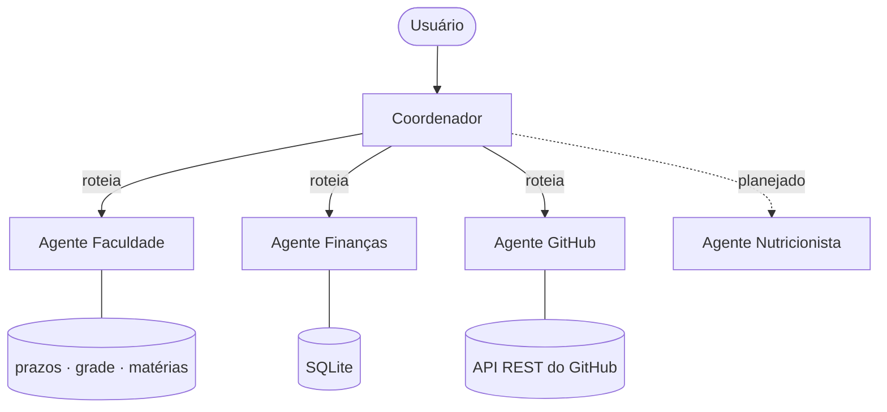
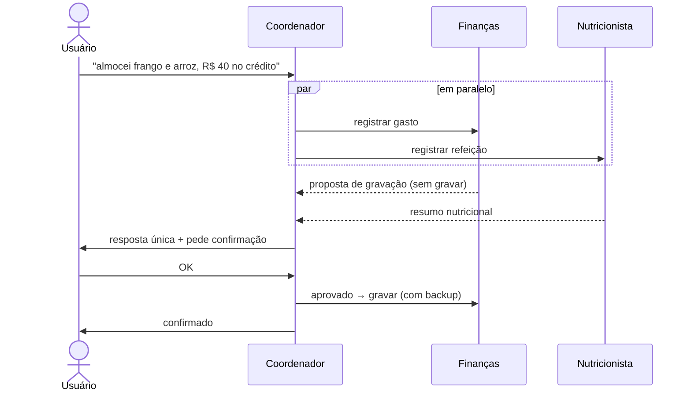

# Sistema Multiagente com Claude


Sistema de **agentes de IA especializados coordenados por um orquestrador**, construído sobre o Claude. O usuário conversa com um único ponto de contato — o **Coordenador** — que identifica as áreas do pedido, delega para os agentes certos (inclusive em paralelo), centraliza as confirmações e devolve uma resposta única.

Uso real no dia a dia para estudos, finanças pessoais e gestão do GitHub.

---

## Destaques

- **Orquestração multiagente** — roteamento por intenção, delegação paralela e consolidação de respostas.
- **Human-in-the-loop** — nenhuma ação irreversível (gravar no banco, push, apagar) acontece sem aprovação; as confirmações sobem dos agentes para o Coordenador.
- **Contexto isolado por agente** — cada especialista carrega só as próprias regras e dados.
- **Agente com banco de dados** — o Agente Finanças opera um SQLite com views de saldo, fatura, limite e carteira, backup automático antes de cada escrita.
- **Código separado dos dados** — o repositório é a fonte única do sistema; os dados de cada usuário ficam em `dados/`, fora do Git. Melhorou um agente? É só um commit.
- **Segurança por padrão** — bancos, perfis e tokens nunca entram no Git; o Agente GitHub varre segredos antes de cada push.
- **Extensível** — adicionar um agente novo leva 3 arquivos.

## Arquitetura



### Exemplo de fluxo — um pedido, duas áreas



Mais detalhes, decisões de projeto e passo a passo em [`docs/ARQUITETURA.md`](docs/ARQUITETURA.md).

## Agentes

| Agente | Responsabilidade | Destaques técnicos |
|---|---|---|
| **Coordenador** | Ponto único de contato, roteamento e consolidação | Delegação paralela, confirmações centralizadas |
| **Faculdade** | Matérias, prazos, resumos e exercícios | Base de conhecimento em Markdown por disciplina |
| **Finanças** | Gastos, cartões, faturas, investimentos e metas | SQLite, valores em centavos, parcelamento, views, backups, painel |
| **GitHub** | Repositórios, READMEs, commits e portfólio | API REST, varredura de segredos, confirmação antes de push |
| **Nutricionista** | Rotina alimentar e acompanhamento | *em desenvolvimento* |

## Exemplo de uso

```text
Usuário:      quanto tenho de investimentos?
Coordenador:  → Agente Finanças
              consulta v_posicao_invest + cotação do dia
              ┌────────┬───────┬──────────┬────────────┐
              │ Ativo  │ Cotas │ Cotação  │ Valor      │
              ├────────┼───────┼──────────┼────────────┤
              │ FII A  │ 100   │ R$ 10,00 │ R$ 1.000   │
              │ ETF B  │ 10    │ R$ 25,00 │ R$   250   │
              └────────┴───────┴──────────┴────────────┘
              Total: R$ 1.250,00
```

## Tecnologias

- **Claude Code** — subagentes (`.claude/agents/`) e instruções por projeto (`CLAUDE.md`)
- **Claude Cowork** — skills de ativação (`/coordenador`, `/financas`, ...)
- **Python + SQLite** — persistência e relatórios do Agente Finanças
- **API REST do GitHub** — automação do Agente GitHub
- **Markdown** — base de conhecimento e regras dos agentes

## Estrutura

```
.
├── CLAUDE.md                  # Coordenador: roteamento e regras gerais
├── .claude/agents/            # subagentes (um por especialista)
├── agentes/                   # CÓDIGO e regras (versionado)
│   ├── AGENTE_FACULDADE/      # regras de estudo
│   ├── AGENTE_FINANCAS/       # regras + schema.sql + db.py + relatórios
│   └── AGENTE_GITHUB/         # regras + modelos de README
├── dados_exemplo/             # modelo da pasta de dados
├── dados/                     # SEUS dados (ignorado pelo Git)
├── skills/                    # skills de ativação para o Claude Cowork
└── docs/ARQUITETURA.md        # arquitetura, decisões e extensão
```

## Como executar

**Pré-requisitos:** [Claude Code](https://docs.claude.com/en/docs/claude-code/overview) (requer plano do Claude) e Python 3.10+.

```bash
git clone https://github.com/hugo808ts/sistema-multiagente-claude.git
cd sistema-multiagente-claude

# cria sua pasta de dados (fora do Git) a partir do modelo
cp -r dados_exemplo dados

# cria o banco vazio do Agente Finanças em dados/financas/
python agentes/AGENTE_FINANCAS/iniciar_banco.py

# (opcional) token do GitHub para o Agente GitHub
# salve em dados/github/token.txt

# inicia o Coordenador
claude
```

Depois é só conversar: *"registra um gasto de R$ 30 no mercado"*, *"quais provas tenho essa semana?"*, *"cria um README para o meu projeto"*.

## Adicionando um agente

1. Criar `agentes/AGENTE_<NOME>/CLAUDE.md` com identidade, regras e estrutura.
2. Criar `.claude/agents/<nome>.md` com `name`, `description` e instruções de delegação.
3. Adicionar uma linha na tabela de agentes do `CLAUDE.md` da raiz.

## Roadmap

- [x] Coordenador com roteamento e delegação paralela
- [x] Agentes Faculdade, Finanças e GitHub
- [x] Painel financeiro gerado a partir do banco
- [ ] Agente Nutricionista com painel de acompanhamento
- [ ] Integração com Microsoft Teams (prazos da faculdade)

## Autor

**Hugo Vieira** — estudante de Sistemas de Informação, focado em automação e agentes de IA.
[GitHub](https://github.com/hugo808ts)

## Licença

[MIT](LICENSE)
