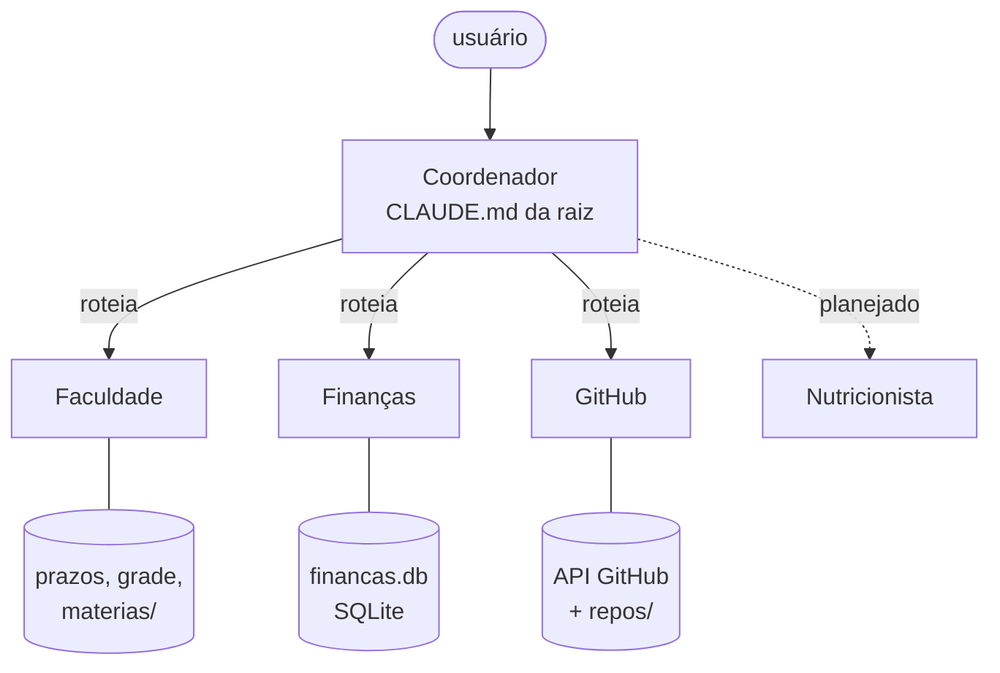
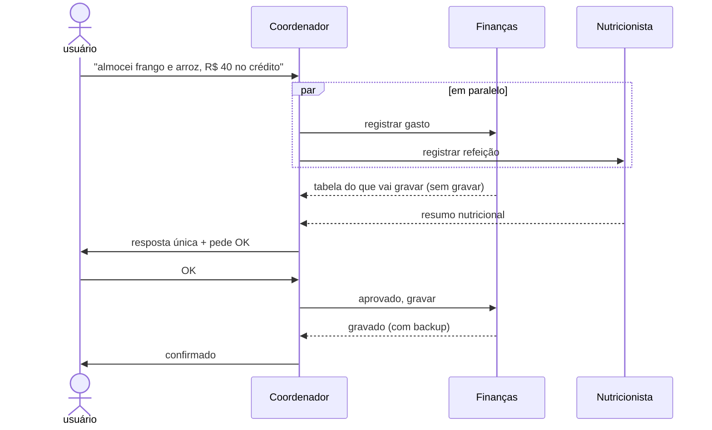

# Arquitetura — Sistema Multiagente

Sistema de agentes de IA especializados, coordenados por um agente principal (padrão **orquestrador + especialistas**), construído sobre o Claude.

## Visão geral



- **Coordenador:** único ponto de contato. Identifica as áreas do pedido, delega, junta as respostas e controla as confirmações.
- **Especialistas:** cada um tem uma pasta própria (o "cérebro") com `CLAUDE.md` (regras), dados e ferramentas. Não mexem na pasta um do outro.

## Estrutura

```
AGENTES_IA/
├── CLAUDE.md                 → Coordenador (roteamento e regras gerais)
├── .claude/agents/           → definição dos subagentes (Claude Code)
│   ├── faculdade.md
│   ├── financas.md
│   └── github.md
├── README.md
├── docs/
│   └── ARQUITETURA.md        → este arquivo
├── agentes/                  → CÓDIGO e regras (no Git)
│   ├── AGENTE_FACULDADE/     → estudos na faculdade
│   ├── AGENTE_FINANCAS/      → finanças pessoais (SQLite + painel)
│   └── AGENTE_GITHUB/        → GitHub e portfólio
├── dados_exemplo/            → modelo da pasta de dados (no Git)
└── dados/                    → DADOS do usuário (fora do Git)
    ├── perfil.md             → contexto geral do usuário
    ├── faculdade/            → perfil, prazos, grade, matérias
    ├── financas/             → perfil, financas.db, backups, painel
    └── github/               → perfil, token, clones
```

## Fluxo de um pedido



## Decisões de projeto

| Decisão | Motivo |
|---|---|
| Uma pasta por agente | Contexto isolado. Cada agente só carrega o que precisa. |
| Código separado dos dados | O repositório é a fonte única: uma melhoria vira commit, sem sincronizar cópias. Dados pessoais nunca ficam junto do código versionado. |
| `CLAUDE.md` só com regras fixas | Instruções enxutas e estáveis. Dados ficam em arquivos/banco. |
| Confirmações centralizadas no Coordenador | Subagentes não falam com o usuário. Nenhuma ação irreversível sem OK. |
| Delegação em paralelo | Pedidos com várias áreas respondem mais rápido. |
| Dados pessoais fora do Git | `.gitignore` bloqueia a pasta `dados/` inteira, além de `*.db`, backups e tokens por segurança extra. |

## Formas de usar

- **Terminal (Claude Code / Orca):** abrir `claude` na pasta `AGENTES_IA`. O `CLAUDE.md` da raiz vira o Coordenador e os arquivos de `.claude/agents/` viram os subagentes.
- **Cowork (chat):** skill `/coordenador`, que carrega o `CLAUDE.md` da raiz e, conforme o pedido, o `CLAUDE.md` do agente da área.
- **Direto num agente:** `/faculdade`, `/financas`, `/github` continuam funcionando sozinhos.

## Como adicionar um agente

1. Criar `agentes/AGENTE_<NOME>/CLAUDE.md` com identidade, regras e estrutura da pasta.
2. Criar `.claude/agents/<nome>.md` (frontmatter `name`, `description`, `tools` + instruções de delegação).
3. Adicionar uma linha na tabela "Agentes disponíveis" do `CLAUDE.md` da raiz.
4. Se o agente gravar dados ou fizer ações irreversíveis: devolver proposta ao Coordenador e só executar após o OK.
5. Atualizar o diagrama deste arquivo.

## Tecnologias
Claude (Claude Code e Cowork), subagentes do Claude Code, Python + SQLite (Finanças), API REST do GitHub, Markdown.
