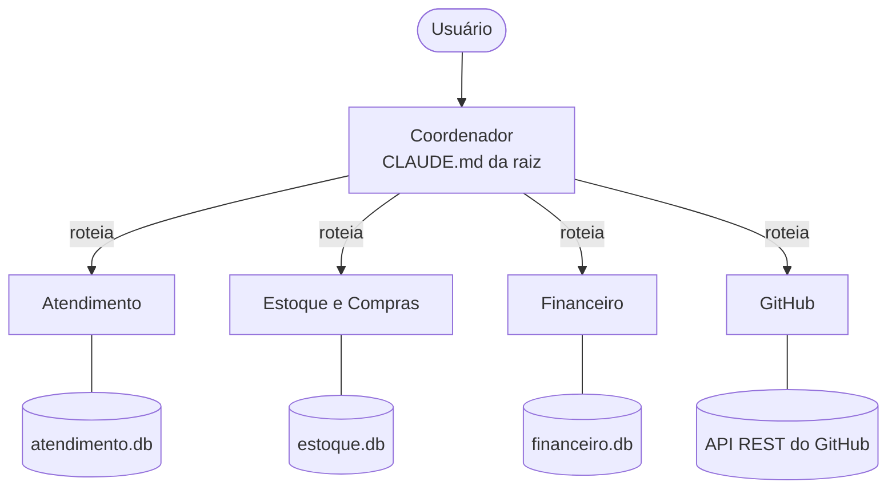
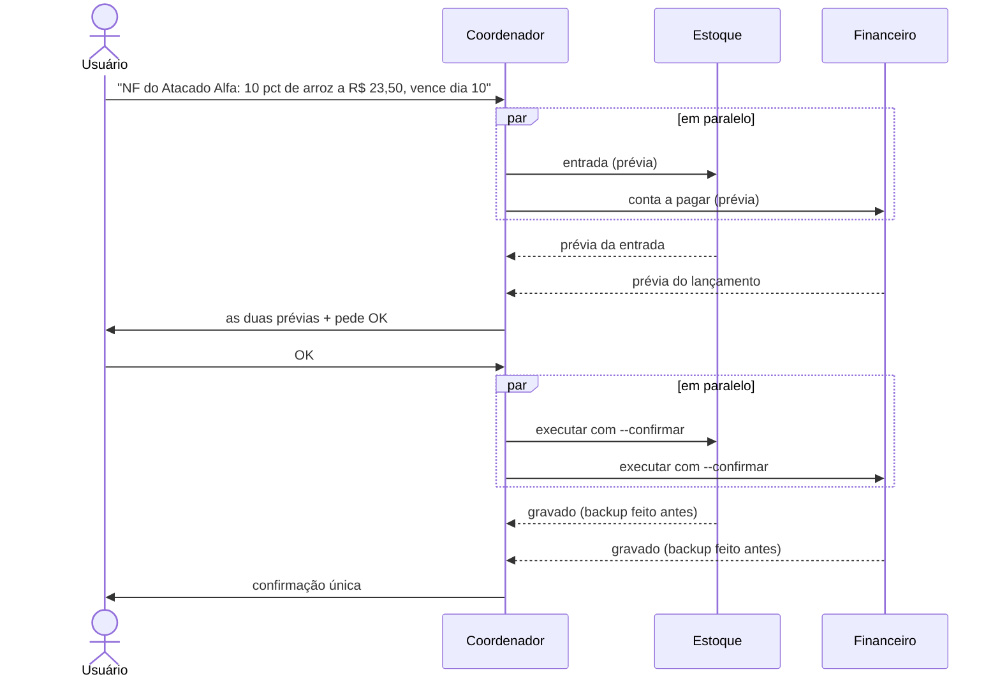

# Arquitetura

O sistema segue o padrão **orquestrador + especialistas**. Um agente coordenador recebe o pedido e distribui o trabalho entre agentes com escopo fechado. Cada especialista tem as próprias regras, ferramentas e banco de dados.

## Visão geral



## Estrutura

```
.
├── CLAUDE.md                → Coordenador: roteamento e regras gerais
├── .claude/agents/          → definição dos subagentes (Claude Code)
├── agentes/
│   ├── AGENTE_ATENDIMENTO/  → CLAUDE.md + schema.sql + atendimento.py
│   ├── AGENTE_ESTOQUE/      → CLAUDE.md + schema.sql + estoque.py
│   ├── AGENTE_FINANCEIRO/   → CLAUDE.md + schema.sql + financeiro.py
│   └── AGENTE_GITHUB/       → CLAUDE.md + modelo de README
├── nucleo/db.py             → conexão SQLite, backup e formatação, comum a todos
├── scripts/iniciar_dados.py → cria os bancos (e carrega a demonstração)
├── tests/                   → testes das ferramentas
├── dados_exemplo/           → exemplos de entrada (JSON de pedido)
└── dados/                   → bancos e backups (fora do Git)
```

## Fluxo de um pedido com duas áreas



## Decisões de projeto

| Decisão | Motivo |
|---|---|
| Uma pasta e um banco por agente | Contexto isolado: cada agente carrega só o que precisa, e um erro numa área não corrompe outra. |
| O modelo não escreve SQL direto | Toda leitura e escrita passa pelos scripts do agente, que validam os dados. O modelo interpreta o pedido; o código garante as regras. |
| Prévia por padrão, `--confirmar` para gravar | Aprovação humana fica no código, não só no prompt. Sem a flag, nada é gravado. |
| Confirmações centralizadas no Coordenador | Subagentes não falam com o usuário. Pedidos com várias áreas viram uma aprovação só. |
| Backup antes de cada gravação | Toda escrita pode ser desfeita. O núcleo guarda os 15 backups mais recentes. |
| Valores em centavos | Inteiros evitam erro de arredondamento em dinheiro. |
| Regras de negócio no banco | `CHECK`, chaves estrangeiras e views (saldo, reposição, fluxo) mantêm os dados coerentes mesmo fora dos scripts. |
| Delegação em paralelo | Áreas independentes respondem ao mesmo tempo. |
| `dados/` fora do Git | Bancos, backups e tokens nunca vão para o repositório. |

## Como adicionar um agente

1. Criar `agentes/AGENTE_<NOME>/` com `CLAUDE.md` (papel, ferramentas, regras) e, se guardar dados, `schema.sql` + script com o padrão prévia/`--confirmar`.
2. Criar `.claude/agents/<nome>.md` com `name`, `description` e `tools`.
3. Adicionar uma linha na tabela "Agentes disponíveis" do `CLAUDE.md` da raiz.
4. Registrar o schema em `scripts/iniciar_dados.py` e escrever os testes em `tests/`.
